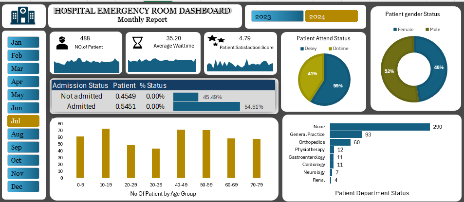

# 🏥 Hospital Emergency Room Dashboard (Monthly Report)

> *An interactive Excel-based healthcare analytics dashboard designed to monitor and analyze emergency room operations, patient wait times, satisfaction scores, admission trends, and department distributions.*

---

## 📋 Table of Contents

- [📌 Project Overview](#-project-overview)
- [🎯 Project Objective](#-project-objective)
- [✨ Key Performance Indicators (KPIs)](#-key-performance-indicators-kpis)
- [🎛️ Dynamic Filters & Controls](#️-dynamic-filters--controls)
- [📊 Visualizations & Metrics Breakdown](#-visualizations--metrics-breakdown)
- [🔄 Data Workflow](#-data-workflow)
- [📈 Dashboard Preview](#-dashboard-preview)
- [🔍 Key Insights](#-key-insights)
- [🛠️ Tools & Techniques](#️-tools--techniques)
- [🚀 Future Improvements](#-future-improvements)
- [👤 Author](#-author)

---

## 📌 Project Overview

The **Hospital Emergency Room Dashboard** analyzes emergency room operations and patient flow using Microsoft Excel. It transforms patient check-in records into interactive visual reports to help healthcare administrators understand patient volume, waiting times, satisfaction levels, admission outcomes, and department-wise distributions.

The dashboard provides a consolidated view of emergency room performance through KPI cards, charts, and interactive filters, supporting operational monitoring and data-driven decision-making.

## 🎯 Project Objective

- Monitor total emergency room visits and patient volume.
- Analyze average patient waiting time and satisfaction scores.
- Compare on-time and delayed patient attendance.
- Evaluate patient distribution across age groups.
- Analyze patient distribution by gender.
- Track hospital admission and discharge outcomes.
- Identify departments receiving the highest number of emergency room referrals.
- Compare monthly and yearly emergency room activity.
- Build an interactive Excel dashboard for healthcare reporting and analysis.

## ✨ Key Performance Indicators (KPIs)

### 💡 High-Level KPI Summary

| **KPI** | **Value** |
|---|---:|
| 🧑‍⚕️ Number of Patients | 488 |
| ⏳ Average Wait Time | 35.20 minutes |
| ⭐ Patient Satisfaction Score | 4.79 / 5.0 |
| 🏥 Hospital Admission Rate | 54.51% |
| 🏠 Not Admitted Rate | 45.49% |

## 🎛️ Dynamic Filters & Controls

- **Year Selection:** 2023, 2024
- **Monthly Slicer:** January to December
- **Selected Month:** July

These interactive filters allow users to explore emergency room metrics for different reporting periods.

## 📊 Visualizations & Metrics Breakdown

### 1. 🕒 Patient Attendance Status

**Chart Type:** Pie Chart

Compares patient attendance delays with on-time attendance.

| **Attendance Status** | **Percentage** |
|---|---:|
| Delayed | 59% |
| On-time | 41% |

### 2. 👥 Patient Gender Distribution

**Chart Type:** Doughnut Chart

Displays the distribution of emergency room visits by gender.

| **Gender** | **Percentage** |
|---|---:|
| Male | 52% |
| Female | 48% |

### 3. 📊 Number of Patients by Age Group

**Chart Type:** Column Chart

Analyzes patient volume across different age groups.

| **Age Group** | **Approximate Patients** |
|---|---:|
| 0–9 | 60 |
| 10–19 | 72 |
| 20–29 | 48 |
| 30–39 | 42 |
| 40–49 | 70 |
| 50–59 | 70 |
| 60–69 | 58 |
| 70–79 | 57 |

### 4. 🏥 Patient Department Distribution

**Chart Type:** Horizontal Bar Chart

Highlights the distribution of patient referrals across hospital departments.

| **Department** | **Patients** |
|---|---:|
| None / Unassigned | 290 |
| General Practice | 93 |
| Orthopedics | 60 |
| Physiotherapy | 12 |
| Gastroenterology | 11 |
| Cardiology | 11 |
| Neurology | 7 |
| Renal | 4 |

### 5. 🏥 Hospital Admission Analysis

Analyzes the proportion of emergency room visits resulting in hospital admission versus those not admitted.

| **Admission Status** | **Percentage** |
|---|---:|
| Admitted | 54.51% |
| Not Admitted | 45.49% |

## 🔄 Data Workflow

This project follows a structured process to convert emergency room records into meaningful healthcare insights.

| **Step** | **Process** | **Purpose** |
|---|---|---|
| 01 | ER Log Data | Collect and review emergency room patient records |
| 02 | Data Cleaning & Validation | Prepare patient records for accurate analysis |
| 03 | KPI Calculation | Calculate patient volume, average wait time, and satisfaction scores |
| 04 | PivotTables & Formulas | Summarize patient metrics by age, gender, department, and admission status |
| 05 | Dynamic Slicers | Enable interactive filtering by year and month |
| 06 | Dashboard Creation | Combine KPIs, charts, and summary metrics |
| 07 | Insight Generation | Identify patient flow patterns and operational improvement opportunities |

**Workflow Summary:**

`ER Log Data → Data Cleaning & Validation → PivotTables & Formulas → Dynamic Slicers → ER Dashboard`

## 📈 Dashboard Preview

## 🔍 Key Insights

Based on the values provided for the dashboard:

- **High Patient Satisfaction:** The displayed patient satisfaction score is 4.79 out of 5.0.
- **Attendance Delays:** 59% of patient attendances are classified as delayed, compared with 41% on time.
- **Patient Waiting Time:** The average waiting time is 35.20 minutes, indicating an opportunity to investigate patient flow and waiting-time reduction.
- **Age Distribution:** The 10–19 age group has the highest displayed patient count, at approximately 72 patients.
- **Gender Distribution:** Male patients account for 52% of visits, while female patients account for 48%.
- **Admission Rate:** 54.51% of patients are admitted, while 45.49% are not admitted.
- **Department Distribution:** The None / Unassigned category contains 290 records, followed by General Practice with 93 and Orthopedics with 60.
- **Interactive Analysis:** Year and month filters help users examine emergency room activity across selected reporting periods.

*Note: These insights reflect the values supplied for the dashboard. Results may change when year or month filters are applied.*

## 🛠️ Tools & Techniques

| **Tool / Technique** | **Purpose** |
|---|---|
| Microsoft Excel | Data processing, analysis, and dashboard creation |
| Excel Formulas | Calculate KPIs and patient metrics |
| Data Cleaning & Validation | Prepare patient records for reliable analysis |
| PivotTables | Summarize patient data across different categories |
| PivotCharts & Charts | Visualize attendance, demographics, and department distributions |
| Pie Chart | Compare patient attendance status |
| Doughnut Chart | Display gender distribution |
| Column Chart | Compare patient counts across age groups |
| Horizontal Bar Chart | Analyze department-wise patient counts |
| Slicers & Interactive Filters | Filter dashboard results by year and month |
| Conditional Formatting | Highlight important values and comparisons |
| KPI Cards | Display key emergency room performance indicators |

## 🚀 Future Improvements

- Add monthly and yearly patient visit trend analysis.
- Analyze waiting times by department and age group.
- Compare admission rates across months and departments.
- Investigate the reasons for delayed patient attendance.
- Improve department classification for unassigned records.
- Analyze patient satisfaction in relation to waiting time.
- Add peak-hour and day-of-week patient volume analysis.
- Track emergency room resource utilization if relevant data is available.
- Integrate the dashboard with Power BI for advanced healthcare reporting.

## 👤 Author

### **Himanshi Sangani**

🎓 Bachelor of Computer Applications (BCA)

**Project:** Hospital Emergency Room Dashboard (Monthly Report)

**Tools:** Microsoft Excel | Data Analysis | Data Visualization
